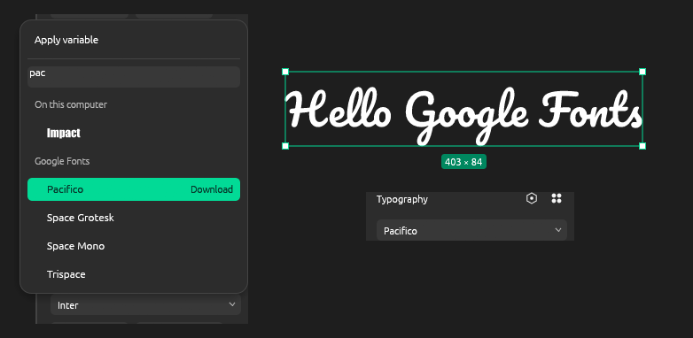

<p align="center">
  
</p>

<h1 align="center">FigCraft · ijuice-j fork</h1>

<p align="center">
  <b>FigCraft, the open-source interface design and prototyping app in pure Rust,<br>
  with Google Fonts in the font picker.</b><br>
  A personal fork of <a href="https://github.com/storytold/figcraft">storytold/figcraft</a> that follows the official project and adds its own changes on top.
</p>

<p align="center">
  
  
  
  
</p>

<p align="center">
  <a href="#what-this-fork-adds">What this fork adds</a> ·
  <a href="#build-and-install">Build and install</a> ·
  <a href="#keeping-up-with-figcraft">Keeping up with FigCraft</a> ·
  <a href="#fork-changelog">Changelog</a> ·
  <a href="#about-figcraft">About FigCraft</a> ·
  <a href="#license-and-credits">License</a>
</p>

> [!IMPORTANT]
> **This is an unofficial fork.** It is based on FigCraft by the ArtCraft team, but it is not made,
> endorsed or supported by them. Official releases, installers and support are at
> [storytold/figcraft](https://github.com/storytold/figcraft). Problems that come from this fork's
> own changes belong in [this fork's issues](https://github.com/ijuice-j/figcraft/issues), not
> upstream.

<br>

## What this fork adds

### Google Fonts in the font picker

FigCraft 0.18 can download a free font only to fix a file that already uses it (Text ▸ Missing
fonts). This fork puts the whole free font library in the font picker, the way design tools with
cloud fonts do: search, pick, and the font is downloaded for you.

<p align="center">
  
</p>

- **Every free family, searchable.** About 1,900 Google Fonts and Noto families from the font
  index FigCraft already ships, listed after your installed fonts under a header per source
  (*On this computer*, *Google Fonts*, *Noto*). Search matches all of them at once.
- **Pick to apply, downloaded in the background.** Picking a family applies it straight away. Its
  files download, are checked against the index's size and SHA-256, and are installed into the
  font folder the Craft apps share; the text then redraws in the real font and auto-sized text
  boxes fit it again.
- **Still nothing online without your say-so.** The first time, the Missing fonts window asks
  *Allow downloading fonts?*; nothing is downloaded until you click **Allow and download**. That
  click remains the only way to turn downloading on: commands, scripts and agents can't.
- **Where it works:** the Typography section of the Design panel and the text style editor. The
  glyphs panel keeps its installed-fonts list. Desktop only; the browser build is unchanged.
- **For scripts and agents:** `font.library {query?, limit?}` lists the same families
  (`{total, families: [{family, source, installed}]}`), and the existing `font.download {family}`
  installs one ([`docs/mcp.md`](docs/mcp.md)).

**Limits.** A family that isn't downloaded yet shows its name in the interface font (there is no
file to preview it in), the picker shows no download progress, and a failed download is reported
only in Text ▸ Missing fonts, which has a *Try again* button.

### Branches

| Branch | What it is |
|---|---|
| **`custom`** (default) | This fork: official FigCraft plus the changes listed in the [changelog](#fork-changelog). Work happens here. |
| `main` | An untouched copy of the official `main` branch, kept to compare against and to bring in updates. |

<br>

## Build and install

There are no prebuilt downloads of this fork. The official installers on the
[upstream releases page](https://github.com/storytold/figcraft/releases) are the official app and
**do not include this fork's changes**.

**You need:** [Rust](https://rustup.rs/) (stable) and Git. On Windows also a C toolchain: either
Visual Studio Build Tools with the MSVC Rust toolchain, or MinGW for the GNU toolchain
(`winget install BrechtSanders.WinLibs.POSIX.UCRT`).

```sh
git clone https://github.com/ijuice-j/figcraft
git clone https://github.com/storytold/craft-fonts    # built-in fonts such as Inter, next to the repo
cd figcraft
cargo build --release -p figcraft                     # the app: target/release/figcraft(.exe)
cargo run --release -p figcraft                       # or build and start it
```

Without `craft-fonts` next to the repository FigCraft builds anyway and falls back to your system
fonts. If you clone it after a first build, run `cargo clean -p figcraft-text` once so the next
build embeds the fonts.

**Install on Windows:** copy `target\release\figcraft.exe` to a folder of its own (for example
`%LOCALAPPDATA%\Programs\FigCraft`) and pin it or add a Start Menu shortcut. It needs no other
files. Your settings and downloaded fonts live in your user profile, so replacing the exe keeps
them.

> [!WARNING]
> **Windows, GNU toolchain: keep the repository out of folders with spaces.** MinGW's `windres`
> can't handle a space in the project path (such as `G:\2026 Projects\…`): the build still succeeds
> but the exe has no icon (the log shows `winresource: Could not compile resource file`). Clone
> into a path without spaces, or point the `WINDRES` environment variable at a wrapper that runs
> `windres` from inside `apps/figcraft` with `-I.`. MSVC builds aren't affected.

**About in-app updates:** this build reports the FigCraft version it's based on. When a newer
official release comes out, FigCraft offers to update at startup. Accepting replaces this fork with
the official app, so decline it and [bring the update into the fork](#keeping-up-with-figcraft)
instead.

<details>
<summary><b>Other platforms, the web build, tests and checks</b></summary>

```sh
cargo run --release -p figcraft-server     # the collaboration server (docs/server.md)
cargo test --workspace                     # the test suite
cargo xtask ci                             # fmt, clippy, tests, layering, asset checks and the wasm build
```

macOS, Linux and FreeBSD build the same way. For the web build, install
[trunk](https://trunkrs.dev/) and run `cargo xtask wasm`. Packaging scripts for real installers
(MSI, DMG, AppImage, Flatpak…) are in [`packaging/`](packaging), described in
[`docs/releasing.md`](docs/releasing.md); the Windows MSI needs the MSVC toolchain, the Windows SDK
and WiX 5.

</details>

<br>

## Keeping up with FigCraft

Official FigCraft moves fast. Check what's new and choose what to bring in:

```sh
git remote add upstream https://github.com/storytold/figcraft   # once, in a fresh clone
git fetch upstream                                              # download, change nothing
git log --oneline custom..upstream/main                         # what's new upstream
```

Then either take everything, or only the changes you want:

```sh
git switch custom
git merge upstream/main            # everything
git cherry-pick <commit>           # or one change at a time
git push
```

Keep `main` as a plain copy of upstream (GitHub's **Sync fork** button, or
`git push origin upstream/main:main`). After a merge, rebuild and reinstall.

If a merge conflicts in this README, keep the fork's version (`git checkout --ours README.md`).
Conflicts in code are usually in the font picker files listed below.

<br>

## Fork changelog

| Date | Change | Main files |
|---|---|---|
| 2026-11-17 | Google Fonts and Noto families in the font picker, downloaded on pick with the existing consent prompt; `font.library` command; tests for the engine, the picker and the consent flow | `crates/engine/src/fonts/download.rs`, `crates/ui-egui/src/panels/typography/picker.rs`, `crates/ui-egui/src/dialogs/missing_fonts.rs` |
| 2026-11-17 | This README, defining the fork | `README.md`, `docs/images/shot-fork-google-fonts.png` |

Based on upstream commit [`4548d6c0`](https://github.com/storytold/figcraft/commit/4548d6c0)
(FigCraft 0.18.1 and `main` as of 2026-11-17).

<br>

---

## About FigCraft

FigCraft is an interface design and prototyping app: frames, auto layout, components and variants,
vector networks, styles, variables and prototypes, in a native app that opens instantly and works
offline. It's open source, written from scratch in Rust, and made by the
[ArtCraft](https://getartcraft.com/) team and community as one of their
[Crafting Apps](https://getartcraft.com/apps). Everything below describes FigCraft itself, which
this fork contains unchanged apart from the changes above.

<p align="center">
  
  <br><sub><b>Ridgeline</b>: auto layout screens built from components, with Light and Dark modes from one set of colour variables · <code>examples/ridgeline-app.figcraft</code></sub>
</p>

<table>
  <tr>
    <td width="25%" valign="top">
      <h3>🎛️ Familiar by design</h3>
      The toolbar, layers panel, Design panel, menus and shortcuts sit right where your hands expect them.
    </td>
    <td width="25%" valign="top">
      <h3>⚡ Native and fast</h3>
      A Rust engine with a persistent document model: edits touch only what changed, so creating a node in a 20,000-node file takes a fraction of a millisecond. No Electron, no web view.
    </td>
    <td width="25%" valign="top">
      <h3>🔌 Offline and private</h3>
      Your files are plain <code>.figcraft</code> archives on your own disk. No account, no telemetry, and nothing leaves your computer unless you share a file or download a font (<a href="#privacy-and-online-sharing">what goes where</a>). SVG, PNG, JPG, WebP and PDF in and out; <code>.fig</code> files open (best effort), and so do designs exported as the public REST API file JSON, with their prototypes and variables.
    </td>
    <td width="25%" valign="top">
      <h3>🤖 Agent-ready</h3>
      Every menu item, tool and drag is a command, so the same engine runs from the UI, the CLI, a JSON control channel or an MCP server.
    </td>
  </tr>
</table>

### A look around

<table>
<tr>
<td width="50%" valign="top">
  
  <p align="center"><sub><b>Components and variants</b>: component sets, variant properties and the Assets panel</sub></p>
</td>
<td width="50%" valign="top">
  
  <p align="center"><sub><b>Prototyping</b>: connections, transitions, back actions and a flow</sub></p>
</td>
</tr>
<tr>
<td width="50%" valign="top">
  
  <p align="center"><sub><b>Developer Mode</b>: ready-for-dev status, annotations and code where component properties become props</sub></p>
</td>
<td width="50%" valign="top">
  
  <p align="center"><sub><b>Vector networks</b>: points and handles, variable-width strokes, booleans that stay editable</sub></p>
</td>
</tr>
<tr>
<td width="50%" valign="top">
  
  <p align="center"><sub><b>Live sessions</b>: cursors, selections, cursor chat and spotlight on one shared file</sub></p>
</td>
<td width="50%" valign="top">
  
  <p align="center"><sub><b>Boards</b>: sticky notes, templates, connectors, a shared timer and voting</sub></p>
</td>
</tr>
</table>

More designs made entirely in FigCraft, with their source files, are in [`examples/`](examples).

### Features

<table>
  <tr>
    <td width="50%" valign="top">
      <h3>Layouts that build themselves</h3>
      Auto layout in both directions, with wrap and grid (fixed, hug and `fr` tracks, cells that span), padding, gaps, alignment including text baselines, Hug / Fill / Fixed sizing, min and max sizes, absolute positioning, drag handles for padding and spacing right on the canvas, and arrow keys that move children through the flow, grid cells and nested frames. Constraints and layout grids for everything else.
    </td>
    <td width="50%" valign="top">
      <h3>Components that scale</h3>
      Main components, instances with overrides that survive edits, component sets with variants, properties, swap instance, detach, reset overrides and go to main component, and an Assets panel with live thumbnails, search and drag-to-canvas into frames and auto layout. Local styles and variables (colour, number, string, boolean) with modes, aliases and scopes, edited in a Variables table and bound to fills, strokes, effects, layout grids and instance properties.
    </td>
  </tr>
  <tr>
    <td width="50%" valign="top">
      <h3>Vectors without compromise</h3>
      Real vector networks: the Pen and Pencil tools, vector edit mode with its own tools (pen, bend, paint bucket, lasso, cut), handle mirroring and per-point corner radius, the shape builder, boolean groups whose operands stay editable, flatten, outline stroke, arrowheads, dashes, per-side and variable-width strokes. Rectangles with smooth (squircle) corners, polygons, stars, and arcs and rings.
    </td>
    <td width="50%" valign="top">
      <h3>Paints and effects</h3>
      Solid, linear, radial, angular and diamond gradients with on-canvas handles, image fills (fill, fit, crop, tile) with adjustments, multiple fills and strokes, every blend mode, drop and inner shadows, layer and background blur (uniform or progressive), noise, texture and glass, masks. Files are sRGB or Display P3, with exports tagged with the file's colour profile.
    </td>
  </tr>
  <tr>
    <td width="50%" valign="top">
      <h3>Type that sets beautifully</h3>
      Text edited in place on the canvas (with inline IME composition), mixed styles within a paragraph, auto width and auto height, line height, letter and paragraph spacing, decoration, case, lists, OpenType features, variable font axes and text styles, right-to-left and mixed-direction text, shaped with HarfRust and the open fonts from craft-fonts plus your system fonts, and in this fork the Google Fonts and Noto libraries from the font picker.
    </td>
    <td width="50%" valign="top">
      <h3>Prototype and hand off</h3>
      Connections, triggers, actions and Smart Animate-style transitions, variables with conditionals, flows, a presentation view with device frames, and a live preview pane. Measurements, annotations, a ready-for-dev list with Compare changes, and code (CSS, HTML, React, Vue, Leptos, SwiftUI, Compose, ArkUI, Flutter) where components take their properties as parameters, comment threads, named version history, and export of any layer at any scale to PNG, JPG, WebP, SVG or PDF.
    </td>
  </tr>
</table>

### Built for agents

Every menu item, tool and gesture runs a command from one registry of 400+ commands. The UI, the
CLI, the JSON control channel and the MCP server all call the same commands, so anything you can
click, a script or an AI agent can do too.

```sh
figcraft-cli render landing.figcraft -o landing.png --scale 2   # headless render
figcraft-cli run build-card.json --out card.figcraft            # a script of commands, no window
figcraft-cli commands --filter font                             # every command, with its parameters
figcraft-cli mcp                                                # MCP server, headless
figcraft-cli mcp --attach 47800                                 # MCP server driving the running app
```

Build the CLI with `cargo build --release -p figcraft-cli`. See
[`docs/control-protocol.md`](docs/control-protocol.md), [`docs/mcp.md`](docs/mcp.md) and
[`docs/cli.md`](docs/cli.md).

### Under the hood

- **Engine first:** a pure-data document model and a command engine, with a thin, swappable egui UI on top. Layering is checked at build time across the workspace crates (`cargo xtask layers`).
- **Persistent data:** the document lives in an immutable ordered map, so undo snapshots are cheap and layout, component sync and text measurement only revisit what changed.
- **Its own renderer:** tiny-skia for the canvas and exports, with layer blending, effects and masks; booleans from linesweeper, geometry from kurbo, text from skrifa and HarfRust.
- **Runs in the browser:** the whole engine and UI compile to WebAssembly.
- **Accessible:** screen reader support through AccessKit, F6 to move between the toolbar, layers, canvas and properties, reduce-motion honoured, and panel text at WCAG AA contrast in both themes.
- **Languages:** English plus reviewed and draft translations, picked in Preferences and switched live ([`docs/translating.md`](docs/translating.md)).
- **Plugins:** sandboxed WebAssembly plugins that act through the same commands ([`docs/plugins.md`](docs/plugins.md)).
- **Live sessions and a server of your own (previews):** share a file online or on the local network and edit it together, or host `figcraft-server` ([`docs/server.md`](docs/server.md)).
- **Never crashes:** no `unwrap`, `expect` or `panic` in shipped code, enforced by clippy; commands run behind a guard so a bug fails one action, not your session.
- **Clean-room:** implemented from public documentation and observed behaviour only. No proprietary code, file formats, icons or images.

> [!NOTE]
> **Status:** FigCraft is in **alpha**. The core editor works end to end, but `.fig` files open
> only best effort and multiplayer is a first preview. Upstream's area-by-area picture is in the
> [roadmap](ROADMAP.md) and [`docs/target-app-parity.md`](docs/target-app-parity.md).
>
> **Known in this build:** on 1080p screens at 100% scaling, small interface text looks softer than
> in other Windows apps. That's FigCraft's own text rendering (no ClearType), the same in the
> official release; a larger Preferences ▸ Interface size helps.

### Privacy and online sharing

FigCraft works offline: it has no account and no telemetry. It contacts a server only when you
share or join a file, or when you download a font.

- **Downloading fonts (this fork makes it easier to reach).** Only after you allow it in the
  Missing fonts window. Picking a Google Fonts or Noto family then sends that family's file
  requests to jsDelivr and GitHub, which host the fonts; nothing about your document is sent. Each
  file is checked against the font index before it's installed.
- **Share ▸ Online uploads the file to a server**, by default the public `collab.craftapps.dev`, or
  your own set in Preferences. The file stays there until you remove it or nobody opens it for 30
  days.
- **It is not end-to-end encrypted.** The connection uses TLS, but whoever runs the server can
  read the file. Don't share confidential work through a server you don't trust; run your own
  ([`docs/server.md`](docs/server.md)) or use the local network.
- **The code or link is the access.** There are no accounts: anyone with an edit link can change
  the file. Stop sharing revokes the links.
- **Share ▸ Local network involves no server**, but isn't encrypted either: use it on networks you
  trust.
- **No guarantees.** The public server is offered as is, without backups or uptime promises. Keep
  your own copy of anything you share. Its terms are in
  [`docs/online-sharing-terms.md`](docs/online-sharing-terms.md).

<br>

---

## License and credits

Like FigCraft, this fork is dual-licensed under [MIT](LICENSE-MIT) or
[Apache-2.0](LICENSE-APACHE), at your option. Copyright (c) 2026 ArtCraft Team and the FigCraft
contributors; this fork's changes are by their authors under the same terms. Required notices are
in [NOTICE](NOTICE).

Every icon in FigCraft is drawn in code or made for the project, and bundled fonts, images and
other assets keep their own open licenses; each is listed with its author, source and license in
[ATTRIBUTION.md](ATTRIBUTION.md). The FigCraft app icon is the project owner's original artwork
under the same MIT OR Apache-2.0 terms ([`assets/app-icon/LICENSE.txt`](assets/app-icon/LICENSE.txt)).

This fork is based on **FigCraft by the ArtCraft team**. The ArtCraft name, wordmark and logos are
trademarks of the ArtCraft Team, aren't covered by the license above, and are not used to present
this fork ([`docs/brand/LICENSE-brand.txt`](docs/brand/LICENSE-brand.txt)). This fork is not an
ArtCraft product.
